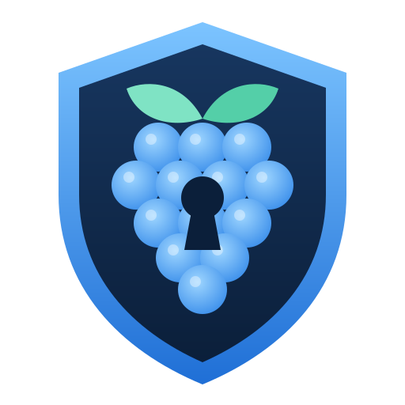
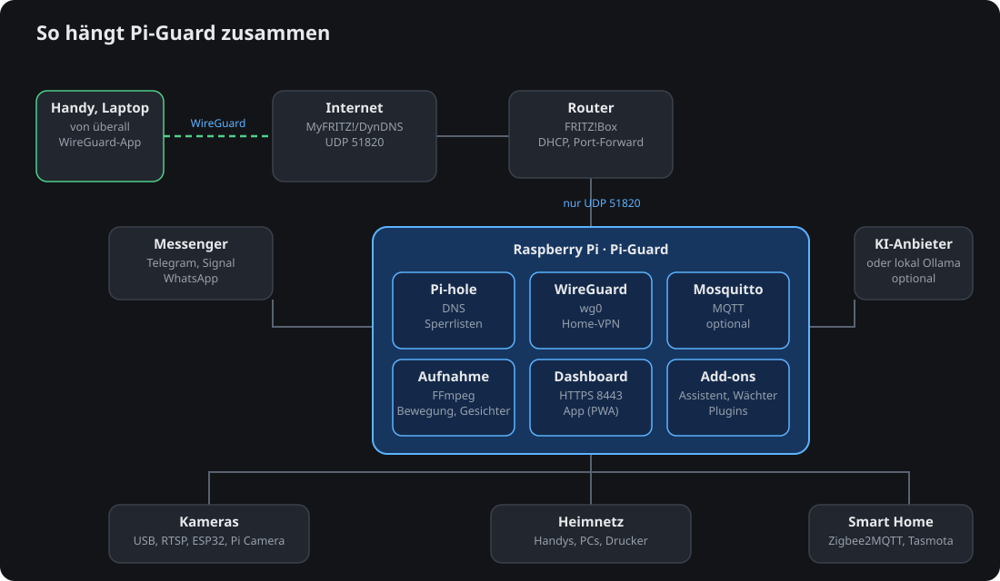

<p align="center"></p>

# pi-guard

Hausüberwachung mit einem Raspberry Pi und einer USB-Kamera, bedient über ein Web-Dashboard,
Apps für Handy und Computer oder Telegram, Signal und Discord. pi-guard zeichnet durchgehend auf die
Speicherkarte auf, erkennt Bewegungen und zeigt Ihnen Ihr Zuhause mit zwei
Knöpfen: **Foto ansehen** und **Video ansehen**.

[English version](README.md)

<p align="center"></p>

## Was pi-guard kann

- **Zeichnet rund um die Uhr auf**, in Abschnitten von fünf Minuten. Alte
  Aufnahmen werden nach einer einstellbaren Zeit gelöscht oder früher, wenn der
  Speicher voll wird.
- **Erkennt Bewegungen**, auf Wunsch nur in bestimmten Bildbereichen oder zu
  bestimmten Uhrzeiten. Licht an- und ausschalten löst keinen Alarm aus.
- **Zuhause und Abwesend.** Zuhause werden Bewegungen nur notiert. Abwesend
  bekommen Sie eine Nachricht mit Foto. Der Modus lässt sich per Knopf, mit
  Zeitbegrenzung oder automatisch über Ihr Handy im WLAN umschalten.
- **Telegram mit großen Knöpfen**, auf Deutsch und Englisch, mit einer
  einfachen Ansicht für den Alltag und einer erweiterten für Administratoren.
  Man kann auch ganz normal schreiben: „Kannst du mir ein Foto schicken?“,
  „Ich bin wieder da“, „Das Bild ist zu dunkel“.
- **Bessere Bilder auf Wunsch:** *Schärfer* sucht das schärfste von mehreren
  Bildern aus und vergrößert auf die Person, *Vergrößern* und *Heller* wirken
  auf das letzte Foto oder die letzte Meldung.
- **Vertraute Personen (optional):** Familienmitglieder mit Namen und Fotos,
  Videos oder einem Kamerabild eintragen – oder direkt aus einer Meldung über
  eine unbekannte Person. Unbekannte Personen werden mit Foto gemeldet.
  Ein Balken zeigt, wie gut jede Person eingeprägt ist und welche Bilder fehlen.
  Mehrere Bilder werden zusammen bewertet, ein einmal schlecht gesehenes
  Familienmitglied gilt also nicht gleich als fremd. *Wer ist das?* an einem
  Ereignis bringt pi-guard ein Gesicht aus der Kamera bei, oder dass ein Gesicht
  nicht jemand ist, auch für viele Gesichter hintereinander per Wischen.
  *Vor der Kamera lernen* nimmt 20 Sekunden verschiedene Ansichten in Blickwinkel und Licht der Kamera auf, und
  *Warum die Erkennung klappt oder nicht* zeigt in Zahlen, was sie bremst.
- **Alarm:** Alarmton (auch einen eigenen) über einen Lautsprecher auslösen
  und wieder stoppen.
- **Notfallkontakte:** Nach einem SOS vom Handy oder wenn Meldungen
  unbestätigt bleiben, bekommen Kontakte eine Nachricht und, was du für jeden
  wählst: Standort, Fotos und Ton, Ereignisse und die Notfalldaten als Link oder PDF.
- **Web-Dashboard (optional):** Live-Bild und -Ton, Sprechen über den
  Lautsprecher, Bildwerkzeuge, vertraute Personen, Geräteauswahl,
  Einstellungen, Statistik und Logs; als App installierbar mit
  Push-Meldungen; Anmeldung mit Passwort oder Schlüsseldatei, optional mit
  Zwei-Faktor-Code oder Hardware-Schlüssel; mehrere Benutzer (Admins und Betrachter);
  eigene Farben, Schrift und Logo; Wochenplan, Sicherheitscheck, Speicher-Bereinigung und
  WLAN-QR-Codes; Barrierefreiheit mit Lupe, Farbfiltern, Vorlesen, sichtbaren Alarmen für Gehörlose,
  Text sprechen für Menschen, die nicht sprechen können, und Befehlen per Sprache oder Chat; ein Tutorial mit Rundgang,
  auch in den Apps, per Assistent und mit `/tutorial` im Chat. Siehe [docs/de/dashboard.md](docs/de/dashboard.md).
- **Netzwerk (optional):** Pi-hole, Geräte im Heimnetz, WireGuard-VPN, ein getarnter Weg für
  Netze, die WireGuard sperren (AmneziaWG),
  optionaler Privacy-Upstream (Multi-Hop / Mullvad / Tor),
  feste IP-Adresse, Hilfe beim Umzug in ein neues Zuhause, an einen neuen Router oder
  Pi ([Umzug](docs/de/backup.md#umzug)). Siehe [docs/de/netzwerk.md](docs/de/netzwerk.md).
- **Optional und standardmäßig aus:** Signal, [Discord](docs/de/discord.md), [E-Mail](docs/de/email.md), [Handy-App](docs/de/mobile.md), Personenerkennung,
  Gesichtserkennung eingetragener Personen, Mikrofon, Lautsprecher, MQTT /
  Home Assistant.
- **Keine Cloud.** Kein Benutzerkonto bei einem Anbieter, keine offenen Ports,
  keine Telemetrie. Nur die Nachrichten, die Sie anfordern, verlassen das Gerät.
  Wer helfen will, kann einen wöchentlichen Bericht mit anonymen Zahlen
  einschalten; vorher zeigt pi-guard genau, was gesendet würde.

## Alles drumherum

| | |
| --- | --- |
| **Web-Dashboard** | Livebild und Ton, Personen, Ereignisse, Wochenplan mit Kalendern, Netzwerk, Einstellungen in einer Normal- und einer Experten-Ansicht. Standardmäßig an unter `https://<pi>:8443`. |
| **Android-App** | Das Dashboard mit Alarmen ohne Google, ein VPN wie bei Mullvad mit Split-Tunneling und automatischem Verbinden, Schnellaktionen wie Alles in Ordnung oder Abwesend am App-Symbol, SOS mit Kamerabildern, Foto und Ton vom Handy und mitverfolgtem Standort, Handy finden und vermisste Handys verfolgen und auf Wunsch ein unauffälliges Aussehen. |
| **Desktop-App** | Das Dashboard im eigenen Fenster für Linux, Windows und macOS, vertraut nur dem Zertifikat deines pi-guard. Unter Linux auch ein VPN mit Kill Switch, Lockdown, Split-Tunneling und quantenresistentem Tunnel. |
| **Server** | Ein kleiner Rust-Agent verbindet PC oder NAS: Status, Sicherheitsprüfung, Updates, Docker, Compose und Git, sicheres Herunterfahren; dazu Dienste, die auf Ausfälle überwacht werden. |
| **Add-ons** | Server, Notfalldaten mit kurzlebigem Link für Rettungskräfte, PDF und Medikationsplan (BMP), Kid Protect mit Filtern und Zeiten ohne Internet für Kindergeräte, Netzwerk-Analyse, Smart Home, Fernbefehle, KI-Assistent mit Kostenanzeige, der auch Einstellungen erklärt und mit Rückgängig ändert, Sprachsteuerung offline mit Weckwort ([Sprache](docs/de/sprache.md)), ein Reverse-Proxy wie frp ([Proxy](docs/de/proxy.md)), weitere Sprachen sowie Alarme nach Slack, Matrix, Rocket.Chat und Mastodon. Jedes lässt sich ausschalten oder samt Daten entfernen. |
| **Plugins** | Eigene Add-ons mit Befehlen, Seiten und API-Routen, als ZIP oder Git-Link, geprüft vor dem Start. |
| **Wege von unterwegs** | IPv4, IPv6, Mietserver oder Tailscale, für jeden Internetanschluss. |
| **Training** | `pgtrain` auf einem Computer mit NVIDIA-Grafikkarte: Bin ich das, ähnliche Fotos, Schwellen aus deinen Fotos und den anonymen Statistiken der Pis, und eine Personenerkennung, die an Bildern von Räumen lernt. Die Bilder bleiben auf diesem Computer. Siehe [Training](docs/de/training.md). |
| **Updates** | Agents und Apps aktualisieren sich selbst mit signierten Versionen, die auch ein gehackter Pi nicht fälschen kann. Auch der Pi installiert nur signierte Versionen, ein gehacktes GitHub-Konto kommt also nicht an ihn heran. Ein Befehl, `scripts/ship.sh`, veröffentlicht alles; neue Haupt- und Unterversionen installieren sich selbst, Korrekturen werden angeboten. |

### Die Apps bekommen

| System | Paket |
| --- | --- |
| Arch Linux | `.pacman`, oder `scripts/install-desktop.sh` mit automatischen Updates |
| Debian, Ubuntu, Linux Mint | `.deb` |
| Fedora, openSUSE | `.rpm` |
| Andere Linux-Systeme | `.AppImage`, Flatpak |
| Windows | `.exe`-Installer |
| macOS | `.zip` |
| Android | `.apk` im Dashboard unter Add-ons › Handy-App |

## Installation

```bash
git clone https://github.com/lytexdev/pi-guard.git
cd pi-guard
sudo ./scripts/install.sh
```

Schritt für Schritt: [docs/de/installation.md](docs/de/installation.md).
Bedienung im Alltag: [docs/de/bedienung.md](docs/de/bedienung.md).

## Datenschutz

Eine Kamera in der Wohnung nimmt auch Menschen auf, die das nicht selbst
entschieden haben: Besuch, Pflegekräfte, Nachbarn, Kinder. Bitte lesen Sie vor
der Installation [docs/de/datenschutz.md](docs/de/datenschutz.md).

## Lizenz

MIT, siehe [LICENSE](LICENSE). Die technische Dokumentation ist auf Englisch
im Ordner [docs](docs). Auf Deutsch gibt es: [Installation](docs/de/installation.md),
[Bedienung](docs/de/bedienung.md), [Dashboard](docs/de/dashboard.md), [Add-ons](docs/de/addons.md),
[Handy-App](docs/de/mobile.md), [Sprache](docs/de/sprache.md), [Netzwerk](docs/de/netzwerk.md),
[Backups](docs/de/backup.md), [Discord](docs/de/discord.md), [E-Mail](docs/de/email.md),
[WhatsApp](docs/de/whatsapp.md), [Reverse-Proxy](docs/de/proxy.md), [Training](docs/de/training.md) und
[Datenschutz](docs/de/datenschutz.md).

## Unterstützen

pi-guard ist kostenlos. Wer es unterstützen möchte, kann freiwillig spenden.

| | |
|---|---|
| Monero (XMR) | `89udnKEYMZCBCaoaTYwSLuJBnQRMVPWxW4kNanra4d4GCdgKN5UNjHKU9zk77jvrU726YQYQqeM2PAUhR8jTMrYU6d5cLMp` |
| Bitcoin (BTC) | `3B8PdpJnmL7rQyHhBytKtvUT7NgQfraBEH` |
| Litecoin (LTC) | `MShzshtse85i6ZkwiB1VKNGRNmEL5Dc3VX` |
