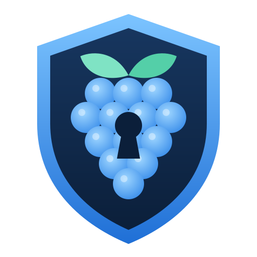
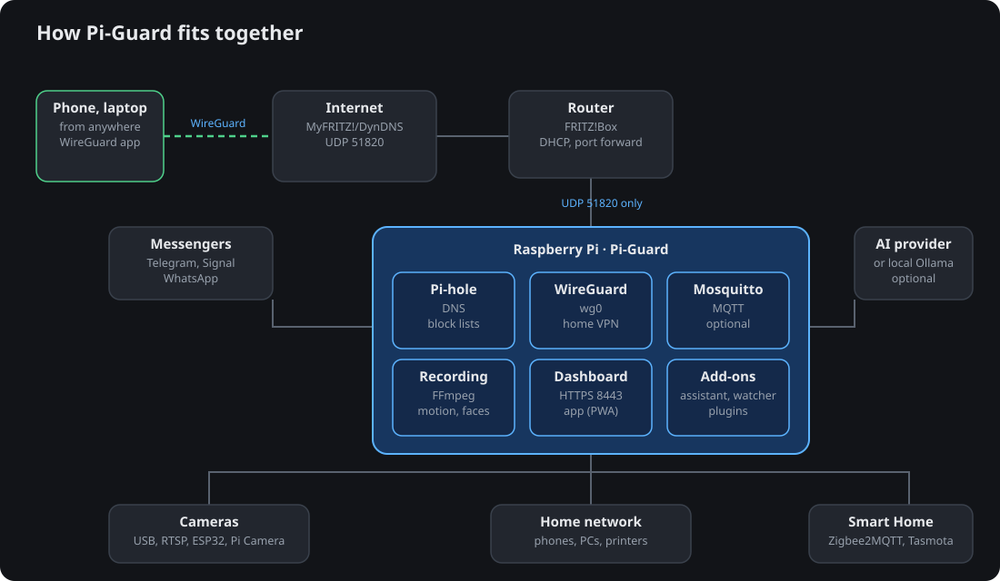

<p align="center"></p>

# pi-guard

Home monitoring for a Raspberry Pi and a USB camera, operated through Telegram
(and optionally Signal). It records continuously to local storage, notices
movement, and lets you look at your home with two buttons: **View photo** and
**View video**.

[Deutsche Version](README.de.md)

<p align="center"></p>

## What it does

- **Records 24/7** to five-minute MP4 segments, using the camera's own H.264
  or the Pi's hardware encoder. Old footage is deleted after a retention
  period or when the disk gets full; the root filesystem is protected.
- **Detects motion** on small low-resolution frames, with zones, schedules and
  filters for light switches and sensor noise.
- **HOME and AWAY modes.** At home, movement is logged but nobody is woken up.
  Away, alerts arrive with a snapshot. The mode can be set by button, command,
  timer, or automatically from your phone's presence in the Wi-Fi.
- **Telegram first.** Large buttons, German and English, a simple view for
  everyday users and an advanced view for administrators. Commands work as plain
  text (`foto`, `video 30`, `abwesend 2h`) and as ordinary sentences
  ("Kannst du mir ein Foto schicken?", "Ich bin wieder da").
- **Better pictures on request.** *Sharper* picks the least blurred of several
  pictures and enlarges the area around a person; *Zoom in* and *Brighter*
  work on the last photo or alert.
- **Trusted people (optional).** Enroll family members with a name and photos,
  videos or a picture taken by the camera — or straight from an alert about an
  unknown person. A bar shows how well each person is learned and which pictures
  are missing. Unknown people are reported with a photo.
- **Alarm.** Sound the alarm (or your own uploaded sound) on a speaker, and stop
  it, from the chat.
- **Emergency contacts.** If alerts stay unconfirmed, backup contacts get a
  summary with photos.
- **Web dashboard (optional).** Live picture and sound, talk through the
  speaker, image tools, trusted people, device selection, settings,
  statistics and logs; installable as an app with push notifications; login
  by password or key file with optional two-factor codes, hardware keys, several users
  (admins and viewers) and your own colours, font and logo. Also a weekly plan, a security
  scan, storage clean-up and Wi-Fi QR codes.
- **Network (optional).** Pi-hole statistics and presence, devices in the LAN,
  WireGuard status, a safe fixed-IP script.
- **Optional, off by default:** Signal (via signal-cli), person detection,
  recognition of enrolled people, microphone clips, speaker playback, MQTT /
  Home Assistant.
- **Nothing leaves the device** except the messages you ask for. No cloud
  account, no open ports, no telemetry.

## Requirements

- Raspberry Pi 4 (2 GB is enough) or Pi 5 with Raspberry Pi OS Lite 64-bit
  (Bookworm or newer); other Debian/Ubuntu ARM64 or x86_64 machines work too
- a USB (UVC) camera; a High Endurance microSD card or a USB SSD
- a Telegram account

See [docs/hardware.md](docs/hardware.md) for tested and expected hardware.

## Installation

```bash
git clone https://github.com/lytexdev/pi-guard.git
cd pi-guard
sudo ./scripts/install.sh
```

The installer asks for the Telegram bot token and your Telegram user ID,
creates a `pi-guard` system user, writes `/etc/pi-guard/pi-guard.env` and a
`config.yaml` for the detected camera, installs a systemd service, and runs
`pi-guard doctor`. Details: [docs/installation.md](docs/installation.md).

Docker Compose is available as an alternative: [docs/docker.md](docs/docker.md).

## Everyday use

Open the bot in Telegram and press **Start**:

```
pi-guard

Your camera is working.

Recording is switched on.

What would you like to do?

[ View photo ]
[ View video ]
[ Camera status ]
[ Notifications ]
[ Help ]
```

Administrators also see **More functions** (mode, events, users, invitations,
sounds). Add family members with **Invite someone**; they receive a link and
join as viewers. Command reference: [docs/telegram.md](docs/telegram.md).

## Command line

```
pi-guard doctor             check camera, encoder, storage, Telegram, Signal
pi-guard status             service state, mode, recordings, recent events
pi-guard cameras            detected cameras and a config snippet
pi-guard mode away --for 3h
pi-guard presence status    one presence check, per source
pi-guard audio devices
pi-guard telegram test --send
pi-guard logs -f
```

## Documentation

| | |
|---|---|
| [Installation](docs/installation.md) | native install, update, uninstall |
| [Configuration](docs/configuration.md) | `.env` and `config.yaml` reference |
| [Telegram](docs/telegram.md) | bot setup, users, commands and aliases |
| [Signal](docs/signal.md) | optional, unofficial; signal-cli setup |
| [Privacy](docs/privacy.md) | what is stored, what leaves the device, legal notes |
| [Hardware](docs/hardware.md) | cameras, audio, storage |
| [Docker](docs/docker.md) | optional container deployment |
| [Dashboard](docs/dashboard.md) | web dashboard, certificates, app and push |
| [Discord](docs/discord.md) | commands and alerts through a Discord bot |
| [Email](docs/email.md) | alerts and exports by email |
| [Mobile app](docs/mobile.md) | Android app with VPN, alerts, finding phones and SOS |
| [Desktop app](docs/desktop.md) | The dashboard as an app for Windows, Linux and macOS |
| [Network](docs/network.md) | Pi-hole, WireGuard, fixed address |
| [Add-ons](docs/addons.md) | Service watcher, network analysis, smart home, remote commands, AI assistant |
| [WhatsApp](docs/whatsapp.md) | Official Cloud API setup and its limits |
| [Public access](docs/public-access.md) | Domain, reverse proxy and safe login |
| [Plugins](docs/plugins.md) | Write your own add-ons |
| [API](docs/api.md) | Tokens and endpoints for your own scripts |
| [Computers](docs/agent.md) | Connect PCs: status, safe shutdown, Docker |
| [Architecture](docs/architecture.md) | how the parts fit together |
| [Performance](docs/performance.md) | measurements and limits |
| [Troubleshooting](docs/troubleshooting.md) | common problems |

German: [Installation](docs/de/installation.md) ·
[Bedienung](docs/de/bedienung.md) · [Dashboard](docs/de/dashboard.md) ·
[Netzwerk](docs/de/netzwerk.md) · [Datenschutz](docs/de/datenschutz.md)

## Privacy

A camera in a home records people who did not choose to be recorded:
visitors, carers, neighbours, children. Read [docs/privacy.md](docs/privacy.md)
before installing. Audio recording and face recognition are switched off by
default and need deliberate configuration.

## License

Licensed under the [MIT LICENSE](LICENSE).

The software is provided "AS IS", without warranty of any kind, to the maximum extent permitted by applicable law.

## Support

pi-guard is free. If you want to support it, donations are welcome and entirely optional.

| | |
|---|---|
| Monero (XMR) | `89udnKEYMZCBCaoaTYwSLuJBnQRMVPWxW4kNanra4d4GCdgKN5UNjHKU9zk77jvrU726YQYQqeM2PAUhR8jTMrYU6d5cLMp` |
| Bitcoin (BTC) | `3B8PdpJnmL7rQyHhBytKtvUT7NgQfraBEH` |
| Litecoin (LTC) | `MShzshtse85i6ZkwiB1VKNGRNmEL5Dc3VX` |
